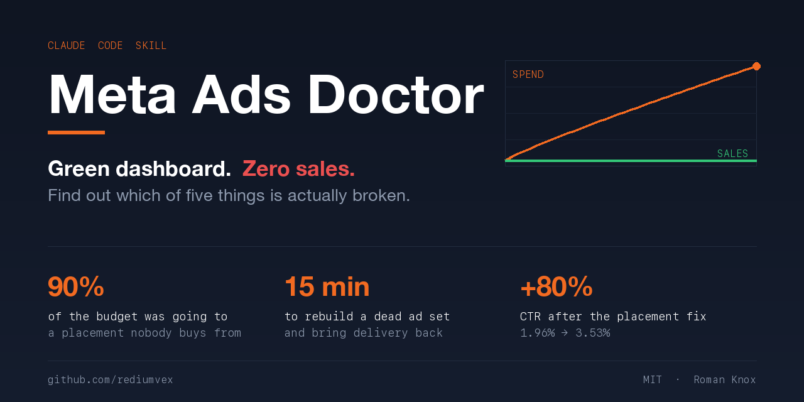
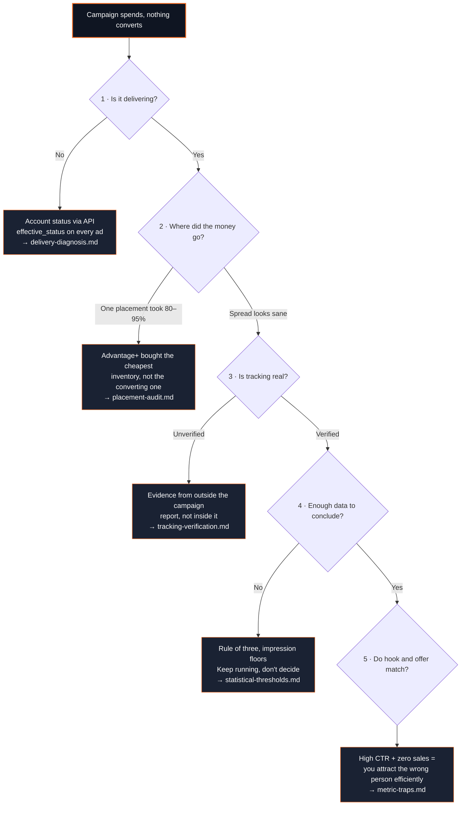

<div align="center">



<br>


[](https://github.com/rediumvex/meta-facebook-ads-optimizer-claude/stargazers)

### Your dashboard is green and you have zero sales.

Cost per click under target. CTR above target. Every number in the black — and nothing in the bank.<br>
**This skill finds the reason, through the Meta Marketing API, in five steps.**

</div>

```bash
cd ~/.claude/skills && git clone https://github.com/rediumvex/meta-facebook-ads-optimizer-claude.git meta-ads-doctor
```

<div align="center">
<sub>Restart Claude Code, then just describe the problem. Built by <a href="https://www.instagram.com/theromanknox/">Roman Knox</a> — 300K+ on Instagram, 600+ stars across my Claude skills.</sub>
</div>

---

## What it found, and what it fixed

Four days in, every metric on my campaign was green. Cost per click under target. CTR above target. Nothing to act on.

One query changed the picture: **90% of the budget had gone to Reels** — swipe traffic that taps a link in motion. The placement where people actually stop and read had received 20 visits in four days. Ads Manager has no view that shows you this. It still doesn't.

Switching placements then triggered a failure mode that isn't in any documentation: delivery collapsed from 400 impressions an hour to **12 in six hours**, with CPM jumping from $3 to $20. The bid model had been calibrated on cheap inventory and could no longer win a single auction.

Diagnosed it from the CPM shift, rebuilt the ad set correctly, and **delivery was back inside 15 minutes** — creative IDs reused so every like and comment on the posts carried over.

| | Before | After |
|---|---:|---:|
| CTR | 1.96% | **3.53%** |
| Budget reaching feed | 5% | **100%** |
| Delivery | 12 impressions / 6h | **2,500+ / day** |

Every step is in [`references/case-study.md`](references/case-study.md) with the real numbers, in order — including the parts where I got it wrong first.

---

## Who this is for

- You're spending on Meta ads and the money isn't coming back
- Delivery dropped and you don't know what you touched
- You have 8 creatives and no idea which two to kill
- Someone told you your pixel is broken and you can't verify it
- Your cost per click looks great and your bank account disagrees

---

## How it diagnoses

A campaign that spends and returns nothing is not one problem. It's five problems that look identical from Ads Manager. The skill runs them in order, cheapest first, and stops at the one that's actually broken.



---

## Four rules that contradict what you'll usually be told

<table>
<tr><td width="50%" valign="top">

### 1. Cheap CPM is a warning, not a win

CPM is a market price set by advertisers who measure conversions. Inventory that stays cheap is cheap **because it didn't convert for them.**

A $3 CPM when your vertical runs $10–25 means you're buying almost entirely Reels — swipe traffic that taps your link in motion, not people who stopped to read.

</td><td width="50%" valign="top">

### 2. Zero conversions never proves broken tracking

A working pixel and a broken pixel produce **identical** campaign data when nobody converts.

Any "tracking must be broken" claim based only on the campaign report is unfounded. The skill goes and gets evidence from outside it.

</td></tr>
<tr><td width="50%" valign="top">

### 3. Never fix an ad set by editing it

Targeting edits reset the learning phase **and** leave the bid model calibrated to inventory you no longer buy.

Real result: delivery went from 400 impressions/hour to **12 in six hours**, CPM jumping $3 → $10–20. Rule: no recovery in ~6 hours means rebuild. A new ad set has no learning history to lose.

</td><td width="50%" valign="top">

### 4. Every threshold must state where it came from

"$0.35 per visit is good" meant nothing — it came from a 2.5% conversion rate measured on **organic** traffic.

Applied to cold traffic it read green for four days while the campaign converted at zero. A green metric built on a borrowed assumption is the most expensive number on a dashboard.

</td></tr>
</table>

---

## The sample-size rules

Most bad ad decisions aren't analysis errors. They're decisions made on samples too small to support any conclusion, dressed up in confident language.

<table>
<tr><th>Visits with 0 conversions</th><th>True rate could still be as high as</th></tr>
<tr><td align="center">100</td><td align="center">3.0%</td></tr>
<tr><td align="center">300</td><td align="center">1.0%</td></tr>
<tr><td align="center">575</td><td align="center">0.52%</td></tr>
<tr><td align="center">1,000</td><td align="center">0.30%</td></tr>
</table>

**Creative culling rule:** cut a creative only when it has **≥300 impressions** *and* costs more than **2× the leader** per landing page view. Below 300 impressions, do nothing.

Why it matters — two real creatives from the same ad set:

| Creative | Impressions | CTR | Verdict |
|---|---:|---:|---|
| A | 59 | **6.8%** | noise — the interval spans 2–17% |
| B | 637 | 5.0% | real |

A looks like the winner. A is not the winner. And one creative in that same set went from $0.94 to $0.25 per click **overnight, unchanged** — anyone who killed it on day one killed a winner.

---

## Usage

Just describe the problem. The skill triggers on ad-diagnosis language, or invoke it directly with `/meta-ads-doctor`.

```
My Facebook ads have spent $400 and I haven't got a single sale. What's wrong?
```
```
Delivery dropped to almost nothing after I changed the targeting yesterday.
```
```
Which of my 11 creatives should I kill?
```
```
Audit this campaign — where is the money actually going?
```
```
почему реклама крутится, а продаж нет
```

> **Requires** access to the Meta Marketing API through an MCP server with read access to your ad account.
> The skill reads freely and **never writes without asking you first.** Money is moving; nothing gets changed behind your back.

<details>
<summary><b>Installing for gstack users</b></summary>

```bash
cd ~/.claude/skills/gstack && git clone https://github.com/rediumvex/meta-facebook-ads-optimizer-claude.git meta-ads-doctor
```
</details>

---

## What's inside

| File | Covers |
|---|---|
| **`SKILL.md`** | Five-step diagnostic order, decision table, edit-vs-rebuild rule, sequencing |
| `references/delivery-diagnosis.md` | Account checks via API, finding the stall hour, reading the CPM shift, full rebuild procedure, what resets learning |
| `references/placement-audit.md` | The breakdown query, the Advantage+ trap, CPM ranges by placement, feed-only targeting JSON |
| `references/tracking-verification.md` | Pixel evidence from outside the campaign, event-name mismatches, click-to-visit gap, attribution windows |
| `references/statistical-thresholds.md` | Rule of three, visits needed per target rate, culling rules, deriving thresholds from unit economics |
| `references/metric-traps.md` | Ten metrics that move without meaning anything |
| **`references/case-study.md`** | The full teardown — every number, every mistake, in order |

<details>
<summary><b>One detail almost everyone gets wrong</b></summary>

<br>

Instagram's main feed placement identifier is **`stream`**, not `feed`:

```json
{
  "publisher_platforms": ["facebook", "instagram"],
  "facebook_positions": ["feed"],
  "instagram_positions": ["stream"]
}
```

Use `feed` for Instagram and the API accepts it, then quietly doesn't deliver where you expect.

</details>

---

## My other Claude skills

<table>
<tr>
<td align="center" width="33%"><a href="https://github.com/rediumvex/ai-video-generator-claude"><b>🎬 AI Video Generator</b></a><br><sub>10 skills for cinematic AI video prompts</sub></td>
<td align="center" width="33%"><a href="https://github.com/rediumvex/social-media-caption-generator-claude"><b>📱 Caption Generator</b></a><br><sub>Algorithm-optimized captions, every platform</sub></td>
<td align="center" width="33%"><a href="https://github.com/rediumvex/viral-hooks-skill"><b>🪝 Viral Hooks</b></a><br><sub>100 hook formulas, 10 psychology triggers</sub></td>
</tr>
<tr>
<td align="center"><a href="https://github.com/rediumvex/ai-marketing-claude"><b>📈 AI Marketing Toolkit</b></a><br><sub>12 skills, 5 subagents, audits to reports</sub></td>
<td align="center"><a href="https://github.com/rediumvex/seo-blog-writer-claude"><b>📝 SEO Blog Writer</b></a><br><sub>Ranks on Google, beats AI detectors</sub></td>
<td align="center"><a href="https://github.com/rediumvex/hormozi-sales-cold-outreach-claude"><b>💰 Hormozi Sales</b></a><br><sub>Grand Slam offers and cold outreach</sub></td>
</tr>
</table>

---

<div align="center">

**I build AI products that make money. Not demos.**

[Instagram](https://www.instagram.com/theromanknox/) · [Knox Community](https://www.skool.com/knox/about)

MIT licensed. Use it, fork it, ship it.

**If this saved you a week of guessing, a ⭐ helps someone else find it.**

</div>
